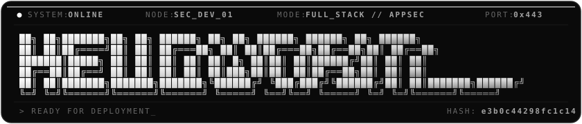

<!-- ── BANNER ASCII GLITCH: HELLO WORLD (ESTILO PGERIG) ── -->


<br/>

<!-- ── ANIMACIÓN DE ESCRITURA TYPING SVG ── -->
<a href="https://github.com/nuveneqra007-rgb">
  
</a>

<br/>

<!-- ── ACCESOS RÁPIDOS STEALTH ── -->
<p align="center">
  <a href="https://portafolio-3d-alexander.vercel.app/" target="_blank">
    
  </a>
  &nbsp;
  <a href="https://secscanner.dpdns.org/" target="_blank">
    
  </a>
  &nbsp;
  <a href="mailto:nuveneqra007@gmail.com">
    
  </a>
</p>

</div>

---

<br/>

<!-- ── SECCIÓN 01: SOBRE MÍ ── -->
## `01` — Sobre Mí

```text
┌──[ alexander@nuveneqra007 ] - [ ~ ]
└─$ cat profile.json
```

```json
{
  "developer": "Alexander",
  "role": "Full-Stack Developer & Cybersecurity Enthusiast",
  "location": "República Dominicana 🇩🇴",
  "focus": [
    "Modern Full-Stack Architecture",
    "Application Security (AppSec) & Threat Hunting",
    "Interactive 3D Web & Creative Experiences"
  ],
  "mindset": "Build elegant · Break limits · Secure everything",
  "status": "Disponible para proyectos innovadores & colaboraciones"
}
```

> *"Transformando código en experiencias visuales fluidas de alto rendimiento y arquitecturas web seguras y resilientes."*

<br/>

---

<br/>

<!-- ── SECCIÓN 02: TECH STACK (ESTILO 0XSAIKAT) ── -->
## `02` — Tech Stack

<div align="center">

<br/>

#### ⚡ Frontend & UI Architecture
<p align="center">
  
  
  
  
  
  
  
  
  
  
  
  
  
</p>

<br/>

#### 🛡️ Cybersecurity & Forensics
<p align="center">
  
  
  
  
  
  
  
  
  
</p>

<br/>

#### 🌌 3D & Creative Coding
<p align="center">
  
  
  
  
  
</p>

<br/>

#### ⚙️ Backend & Systems
<p align="center">
  
  
  
  
  
  
  
</p>

<br/>

#### 🛠️ DevSecOps & Tools
<p align="center">
  
  
  
  
  
  
  
  
  
</p>

</div>

<br/>

---

<br/>

<!-- ── FOOTER WAVE DE CIERRE AL HACER SCROLL ── -->
<div align="center">

<p align="center">
  <sub style="color: #666666; font-family: monospace;">Design & Architecture · Alexander · Local-First & Cyber Noir</sub>
</p>


</div>
