<!-- ── HERO MINIMALISTA: ALEXANDER + EMBLEMA APPSEC 3D ── -->

 

<!-- ── ANIMACIÓN DE ESCRITURA TYPING SVG (CARACTERES ESPECIALES) ── -->

 

<!-- ── ACCESOS RÁPIDOS STEALTH + TERMINAL GREEN ── -->

  
  &nbsp;
  
  &nbsp;
  
  &nbsp;
  
  &nbsp;
  
  &nbsp;
  

  

### Sobre mí

Soy desarrollador Full-Stack y entusiasta de la ciberseguridad desde **República Dominicana**. Construyo aplicaciones web modernas, experiencias interactivas en 3D y herramientas enfocadas en seguridad defensiva y análisis de amenazas (**SecScanner**, **Nova AI**, **Portfolio 3D**).

> *"Transformando código en experiencias visuales fluidas de alto rendimiento y arquitecturas web seguras y resilientes."*

  

### Tech Stack

 

#### ⚡ Frontend & UI Architecture

  
  
  
  
  
  
  
  
  
  
  
  
  

 

#### 🛡️ Cybersecurity & Forensics

  
  
  
  
  
  
  
  
  

 

#### 🌌 3D & Creative Coding

  
  
  
  
  

 

#### ⚙️ Backend & Systems

  
  
  
  
  
  
  

 

#### 🛠️ DevSecOps & Tools

  
  
  
  
  
  
  
  
  

 

  

<!-- ── ACTIVIDAD: SNAKE CONTRIBUTION GRID ── -->

 

<!-- ── FOOTER WAVE DE CIERRE AL HACER SCROLL ── -->

  Design & Architecture · Alexander · Local-First & Cyber Noir // Terminal Green

